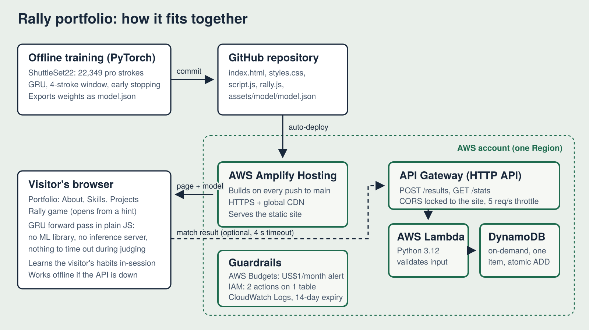

# Shermaine Yap: portfolio + Rally

My portfolio for the **AWS Student Builder Challenge: Build Your Tech Superpower** (Oct–Nov 2026), hosted on AWS Amplify Hosting.

**Live site:** _coming soon on AWS Amplify_

## The creative feature: Rally

For my final-year deep learning module I built models that forecast the next stroke in professional badminton. Rally turns that into something you can play.

Click the shuttlecock ("Rally against my model") and you're on court against a neural network. Every time the shuttle comes to you, the model **locks in a guess for your next shot before you choose**. If it guesses right, it has read you and wins the point. Get three shots past it in one rally and the point is yours. First to five.

- The model is a GRU trained on 22,349 strokes from professional singles matches (ShuttleSet22).
- It runs **directly in your browser**: I export the weights to JSON and wrote the GRU forward pass in plain JavaScript, so there's no ML library and no inference server. The JS output matches PyTorch to within 0.0001 on test inputs.
- It **adapts to you**. Alongside the pro model it keeps a tally of what you play after each shot, and leans on it more as evidence grows (up to 65%). Humans fall into habits quickly.
- Your options are **real badminton**: after each incoming shot you only get replies professionals actually use at least 3% of the time.
- Finished matches go to a small **serverless leaderboard** (API Gateway → Lambda → DynamoDB), so the end screen shows how often the model reads visitors overall.

## Architecture



| AWS service | What it does here | Why this choice |
|---|---|---|
| Amplify Hosting | Serves the static site over HTTPS, redeploys on every push to `main` | No build step needed; CDN and HTTPS out of the box |
| API Gateway (HTTP API) | `POST /results`, `GET /stats`; CORS locked to the site; throttled to 5 req/s, burst 10 | Cheaper and simpler than REST API for two routes |
| Lambda (Python 3.12, arm64, 128 MB) | Validates each result (rejects impossible scores) and updates totals | Pay per request; arm64 is the cheaper architecture |
| DynamoDB (on-demand) | One item holding global totals, updated with atomic `ADD` | No scans, no race conditions, one write per match |
| IAM | Lambda can only `GetItem` and `UpdateItem` on that one table | Least privilege |
| CloudWatch Logs | Lambda logs, deleted after 14 days | Debugging without storage creep |
| AWS Budgets | Emails me at 50% of US$1/month actual, or 100% forecast | A viral link can't become a surprise bill |
| CloudFormation | Whole backend in one template (`backend/template.yaml`) | Reproducible; deploys from the console with no CLI |

**Designed to stay up during judging:** the model ships with the page (no server to time out). If the leaderboard API is down, the game still plays and shows your own stats. If the model files fail to load, the game still runs and learns only from you. All three modes are covered by the browser test.

## Model results

Held-out test set: 9,909 next-shot predictions from 860 rallies the model never saw.

| Model | Top-1 | Top-3 |
|---|---|---|
| Always guess the most common shot | 23.0% | 56.9% |
| Bigram (last shot only) | 52.6% | 93.6% |
| **GRU, 4-stroke window** | **52.5%** | **94.0%** |

The honest finding: from shot types alone, the GRU ties the bigram on top-1 and edges it on top-3. Most of the signal is in the last shot, which matches what I found in my coursework (a 2-stroke window beat longer ones). I kept the GRU because its top-3 is better and because the in-browser GRU was the engineering challenge I wanted to solve.

## Repo layout

```
index.html, styles.css, script.js   the portfolio
rally.js                            the game, the GRU forward pass, the leaderboard client
config.js                           paste your API URL here
assets/model/                       model.js / model.json (weights) and metrics.json
training/train_model.py             retrains the model from ShuttleSet22 and exports it
backend/                            Lambda handler, CloudFormation template, unit tests
tests/e2e_test.py                   headless Chrome test of the whole site and game
docs/architecture.svg/.png          the diagram above
```

## Run it locally

Open `index.html` in a browser. Everything works from disk; the leaderboard only shows up once `config.js` points at a deployed API.

Tests: `python -m pytest backend -q` and `python tests/e2e_test.py` (needs `pip install playwright pytest`).

Retrain: `python training/train_model.py --data "<CoachAI-Projects>/CoachAI-Challenge-IJCAI2023/Track 2: Stroke Forecasting/data" --out assets/model` (needs PyTorch, pandas). Seeded, so it reproduces the numbers above.

## Credits

Stroke data: ShuttleSet22 from the [CoachAI Badminton Challenge](https://github.com/wywyWang/CoachAI-Projects) (IJCAI 2023), MIT licence. Fonts: Barlow and Barlow Condensed (Google Fonts).
